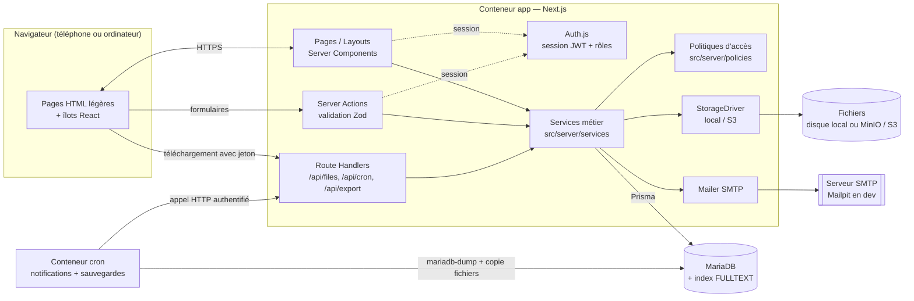
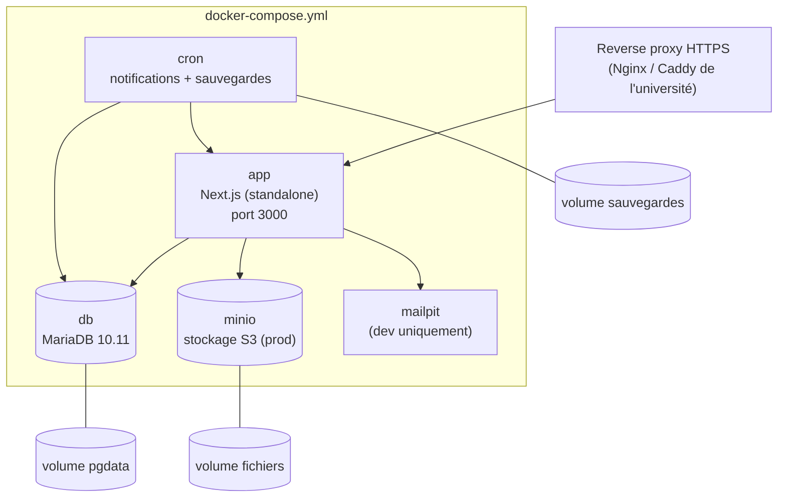

# Architecture — RessourcesPéda

## 1. Vue d'ensemble

Il s'agit d'une application web **monolithique full-stack** en Next.js (App Router). Les pages sont rendues côté serveur (React Server Components), ce qui limite le JavaScript envoyé au téléphone. Les mutations passent par des **Server Actions** (protégées contre le CSRF par Next.js). Quelques **Route Handlers** servent les fichiers, l'export CSV et les tâches planifiées.



## 2. Organisation du code (prévue)

```
.
├── prisma/
│   ├── schema.prisma
│   ├── migrations/            # dont l'index plein texte (SQL brut)
│   └── seed.ts                # données de démonstration (Master MIO)
├── src/
│   ├── app/                   # routes Next.js (App Router), libellés en français
│   │   ├── (auth)/connexion, mot-de-passe-oublie, reinitialisation
│   │   ├── (app)/mes-cours            # F20 — étudiant
│   │   ├── (app)/catalogue/[...]      # F17 — formation › semestre › UE › EC
│   │   ├── (app)/recherche            # F18, F19
│   │   ├── (app)/ressources/[id]      # fiche, aperçu, versions
│   │   ├── (app)/mes-ressources       # enseignant : liste, dépôt, édition
│   │   ├── (app)/validations          # responsable : F14
│   │   ├── (app)/tableau-de-bord      # F23, F24
│   │   ├── (app)/admin/...            # utilisateurs, formations, années, journal
│   │   └── api/
│   │       ├── files/[token]/route.ts # téléchargement / aperçu contrôlé
│   │       ├── cron/notifications/route.ts
│   │       └── export/stats/route.ts  # F26
│   ├── components/            # composants d'interface (Tailwind)
│   ├── server/
│   │   ├── auth.ts            # configuration Auth.js
│   │   ├── db.ts              # client Prisma unique
│   │   ├── policies/          # canViewResource, visibleResourcesWhere, canUploadToEc…
│   │   ├── services/          # resources, versions, catalog, enrollments, stats, audit…
│   │   ├── storage/           # StorageDriver, LocalStorage, S3Storage
│   │   └── mail/
│   ├── lib/                   # utilitaires purs (formats, dates, validation Zod)
│   └── i18n/fr.ts             # libellés et messages d'erreur en français
├── tests/
│   ├── unit/                  # politiques, validations (sans base)
│   ├── integration/           # services + MariaDB de test (RG1–RG10)
│   └── e2e/                   # Playwright : parcours par rôle
├── docker/                    # Dockerfile, scripts de sauvegarde
├── docker-compose.yml
└── .env.example
```

## 3. Principes de conception

### 3.1 Contrôle d'accès centralisé (RG2 à RG7)

Toute la logique « qui voit quoi » (voir [`ambiguites.md` §A4](ambiguites.md#a4-qui-voit-quoi-exactement--rg2-à-rg7--)) est écrite **une seule fois**, dans `src/server/policies/resource-policy.ts`, sous deux formes construites à partir des mêmes règles :

- `visibleResourcesWhere(user): Prisma.ResourceWhereInput` : filtre appliqué à **toutes** les listes et recherches ;
- `canViewResource(user, resource): boolean` : vérification d'une ressource précise (fiche, téléchargement).

Un test vérifie que les deux formes donnent le même résultat sur un jeu de cas (matrice rôle × statut × visibilité × date × type). Autres politiques : `canUploadToEc`, `canEditResource`, `canApprove`, `canManageProgram`, `canHardDelete`.

### 3.2 Couche service

Les pages et les actions ne touchent jamais Prisma directement. Un service :
1. valide l'entrée avec Zod ;
2. vérifie la politique d'accès ;
3. effectue l'opération dans une transaction ;
4. écrit le **journal d'audit** (F25) dans la même transaction.

### 3.3 Fichiers et téléchargements

- Clé de stockage aléatoire (`<annee>/<uuid>`), sans rapport avec le nom d'origine. Le nom d'origine est gardé en base pour `Content-Disposition`.
- L'envoi est validé côté serveur : taille ≤ 100 Mo, extension autorisée **et** signature binaire du fichier (RG8). L'envoi se fait en flux, sans charger le fichier en mémoire.
- Le téléchargement passe par `/api/files/[token]` : un jeton HMAC (versionId, userId, expiration de 10 min) est généré **après** `canViewResource`. Le handler revérifie l'accès, enregistre la consultation (RG10) et sert le flux, avec prise en charge de `Range` pour la vidéo. En production S3, il redirige vers une URL pré-signée de courte durée.
- Aperçu (F12) : PDF dans le lecteur du navigateur (`inline`), images, `<video>` et `<audio>` natifs, intégration YouTube et Drive pour les liens. L'aperçu n'est chargé qu'au clic sur « Aperçu », pour économiser la bande passante.

### 3.4 Recherche (F18, F19)

- Index `FULLTEXT` InnoDB sur (`title`, `keywords`, `description`), interclassement `utf8mb4_unicode_ci` : « résumé » trouve « resume ».
- Requête `MATCH(...) AGAINST(? IN BOOLEAN MODE)` : chaque mot saisi devient obligatoire et peut être tronqué (`simplex*`). Elle est combinée au filtre de visibilité et aux filtres (type, enseignant, année, format), avec un tri par pertinence et une pagination.
- Pertinence : le titre compte double (un second `MATCH` sur le titre seul, avec un index `FULLTEXT` dédié).
- Limites de MariaDB : pas de racinisation du français (« cours » ne trouve pas « course ») et une taille minimale de mot de 3 caractères (`innodb_ft_min_token_size=3`, réglé dans la configuration du conteneur ; la liste de mots vides InnoDB par défaut est en anglais, une liste française est fournie). La troncature `*` compense en partie l'absence de racinisation.
- Objectif : moins de 2 s pour 10 000 ressources, vérifié par un test de charge au Lot 6 avec des données générées.

### 3.5 Faible débit et mobile

- Rendu serveur, peu de JavaScript côté client (formulaires HTML qui fonctionnent même avant l'hydratation).
- Listes paginées par 20, aperçus et images en `loading="lazy"`, images converties en WebP.
- Pas de police web externe (polices système), icônes SVG en ligne.
- Budget : moins de 150 Ko transférés pour une page de liste (hors aperçus).

### 3.6 Sécurité

| Menace | Mesure |
| --- | --- |
| Injection SQL | Prisma (requêtes paramétrées) ; le SQL brut de recherche utilise `Prisma.sql` avec paramètres ; les opérateurs booléens saisis par l'utilisateur (`+ - < > ( ) ~ " @`) sont neutralisés avant `AGAINST` |
| XSS | Échappement React ; aucun `dangerouslySetInnerHTML` ; en-têtes CSP ; fichiers servis avec `X-Content-Type-Options: nosniff` et `Content-Disposition: attachment`, sauf pour les types d'aperçu sûrs (PDF, image, vidéo) |
| CSRF | Server Actions (vérification d'origine) ; cookies `SameSite=Lax`, `HttpOnly`, `Secure` |
| Accès non autorisé | Politiques côté serveur sur chaque lecture ; jetons de téléchargement signés et à durée limitée |
| Force brute | Limitation des tentatives de connexion (par adresse IP et par compte) ; message d'erreur générique |
| Mots de passe | argon2id ; jeton de réinitialisation à usage unique, haché en base, expiration 1 h |
| Énumération de comptes | Le formulaire « mot de passe oublié » répond toujours de la même façon |

### 3.7 Tâches planifiées

Un petit conteneur `cron` (image Alpine) :
- appelle `POST /api/cron/notifications` toutes les 10 minutes, avec un secret partagé `CRON_SECRET`, pour envoyer les notifications des ressources dont la date de publication vient d'être atteinte (F22) ;
- lance chaque nuit `mariadb-dump --single-transaction` et une copie des fichiers vers le volume de sauvegarde, avec une rétention de 14 jours ;
- lance chaque mois l'anonymisation des consultations de plus de 2 ans (A12).

## 4. Déploiement



Variables d'environnement (détaillées dans `.env.example`) : `DATABASE_URL`, `AUTH_SECRET`, `APP_URL`, `STORAGE_DRIVER` (`local`|`s3`), `STORAGE_LOCAL_DIR`, `S3_ENDPOINT`, `S3_BUCKET`, `S3_ACCESS_KEY`, `S3_SECRET_KEY`, `SMTP_HOST`, `SMTP_PORT`, `SMTP_USER`, `SMTP_PASSWORD`, `MAIL_FROM`, `FILE_TOKEN_SECRET`, `CRON_SECRET`, `MAX_UPLOAD_MB`.

## 5. Stratégie de tests

| Niveau | Outil | Contenu |
| --- | --- | --- |
| Unitaires | Vitest | Politiques d'accès (matrice complète), validation des fichiers (RG8), schémas Zod, calcul du niveau à partir du semestre |
| Intégration | Vitest + MariaDB de test (base réinitialisée entre les suites) | Services : RG1 à RG10, versions, archivage, recherche, journal |
| Bout en bout | Playwright | Un parcours par lot : connexion par rôle (Lot 1), dépôt puis publication puis visibilité étudiante (Lot 2), recherche en 3 clics (Lot 3), examen programmé et validé (Lot 4), tableau de bord (Lot 5) |

Correspondance règles et tests (nom des tests : `RGx — …`) :

| Règle | Lot | Test principal |
| --- | --- | --- |
| RG1 | 2 | refuser une ressource sans EC ; hiérarchie EC→UE→Semestre→Formation (Lot 1) |
| RG2 | 2 | refuser le dépôt d'un enseignant non affecté ; collègue voit une ressource `TEACHERS` |
| RG3 | 2 | brouillon et archive invisibles pour l'étudiant |
| RG4 | 2 | matrice des visibilités |
| RG5 | 4 | examen invisible avant la date, puis avant la validation, puis visible |
| RG6 | 2 | nouveau fichier ⇒ version n+1 ; anciennes versions réservées à l'auteur et au responsable |
| RG7 | 3 | étudiant d'une autre formation, d'un autre niveau ou d'une année passée : rien |
| RG8 | 2 | taille, extension, signature binaire, liens externes |
| RG9 | 2 | « supprimer » une ressource publiée l'archive ; suppression définitive réservée à l'administrateur |
| RG10 | 3 | vue et téléchargement enregistrés |
