# Diagrammes UML — RessourcesPéda

Tous les diagrammes sont en Mermaid : GitHub et la plupart des éditeurs Markdown les affichent directement.
Mermaid n'a pas de type « cas d'utilisation » natif. Le diagramme de cas d'utilisation est donc dessiné en `flowchart`, avec les conventions UML : acteurs à gauche, cas d'utilisation en ovales, `«include»` et `«extend»` en pointillés.

## 1. Diagramme de cas d'utilisation

### 1.1 Héritage entre acteurs

Les rôles se cumulent (F2). Le responsable de formation est un enseignant doté de droits supplémentaires. L'administrateur a tous les droits du responsable sur toutes les formations (A3).

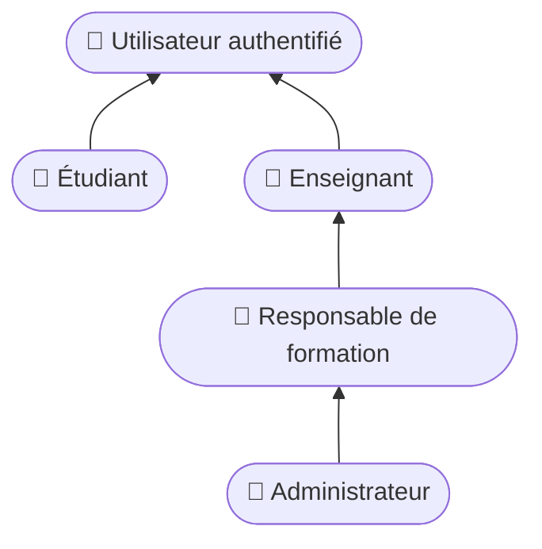

### 1.2 Cas d'utilisation par acteur

Un diagramme par acteur, pour la lisibilité. Chaque acteur hérite aussi des cas des acteurs qu'il spécialise (§1.1).

#### Visiteur et étudiant

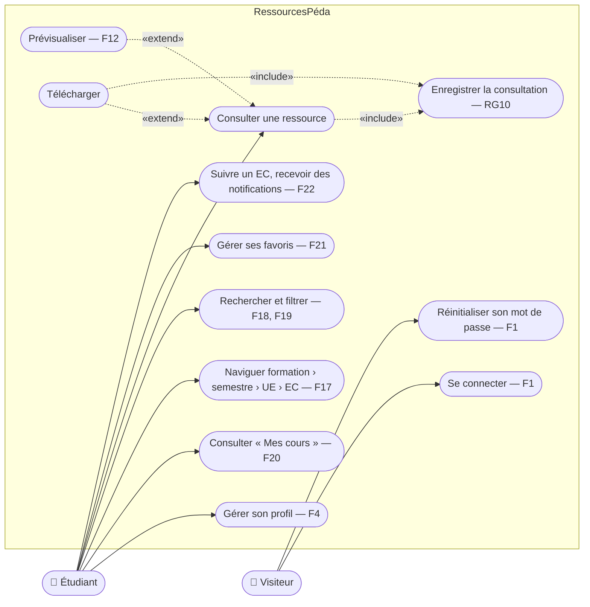

#### Enseignant

L'enseignant dispose aussi des cas de consultation : profil, navigation, recherche, consultation, favoris, suivi d'EC.

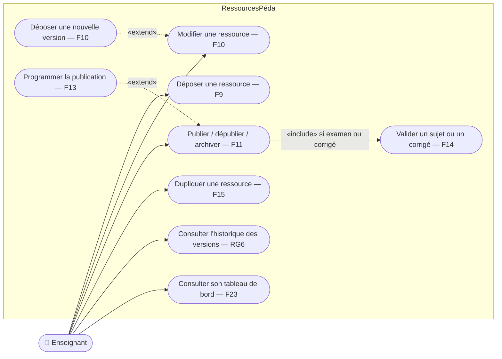

#### Responsable de formation

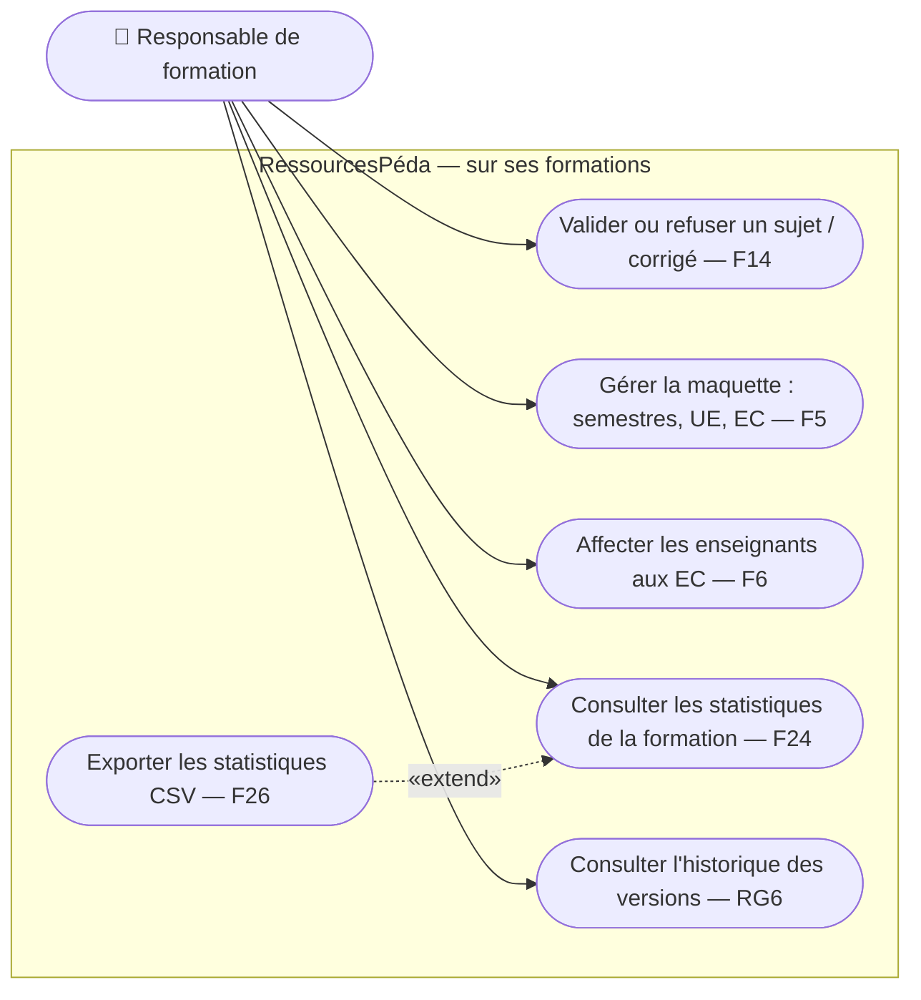

#### Administrateur et planificateur

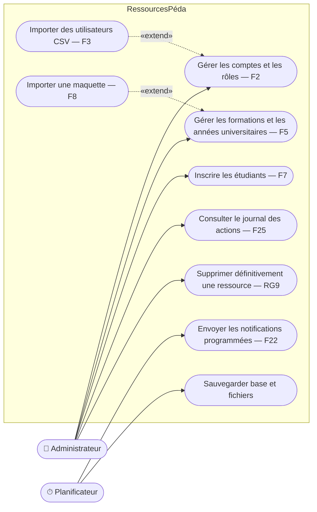

## 2. Diagramme de classes (domaine)

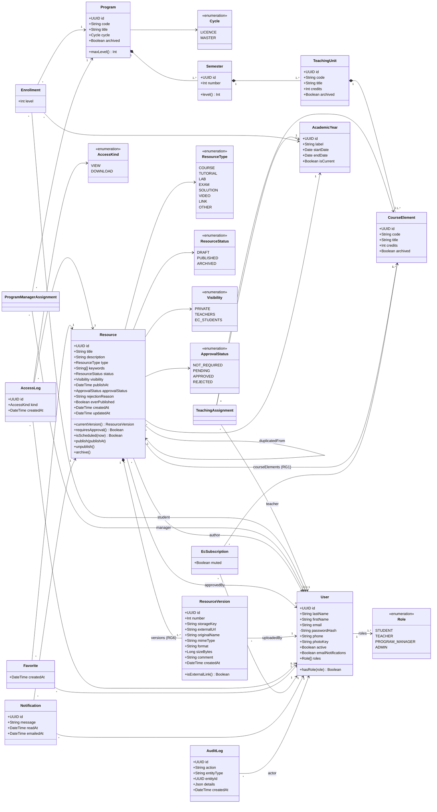

### Classes de service et de politique (architecture)

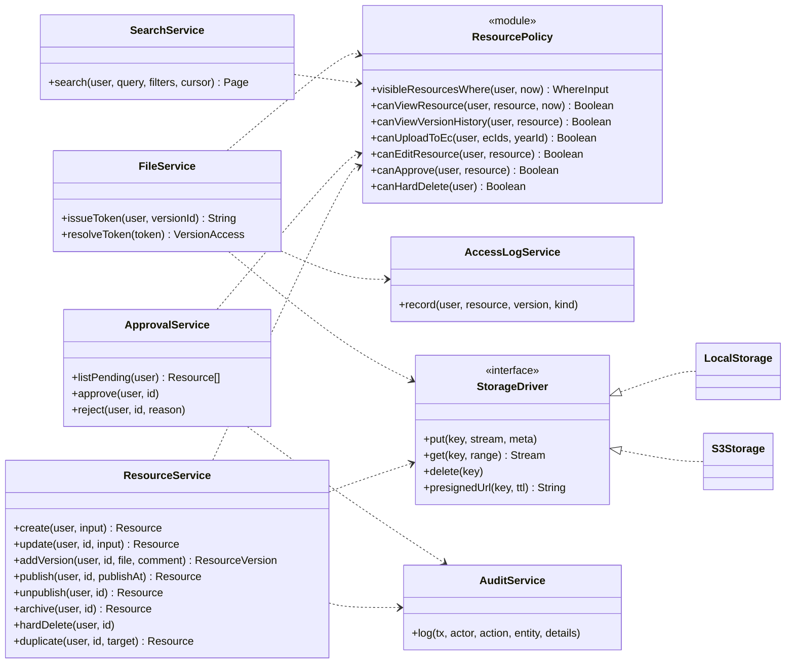

## 3. Cycle de vie d'une ressource

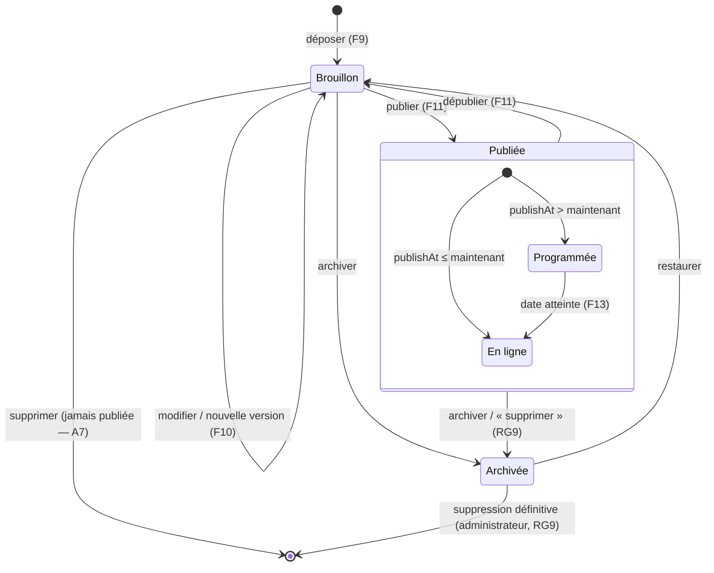

### Validation des sujets d'examen et corrigés (RG5, F14)

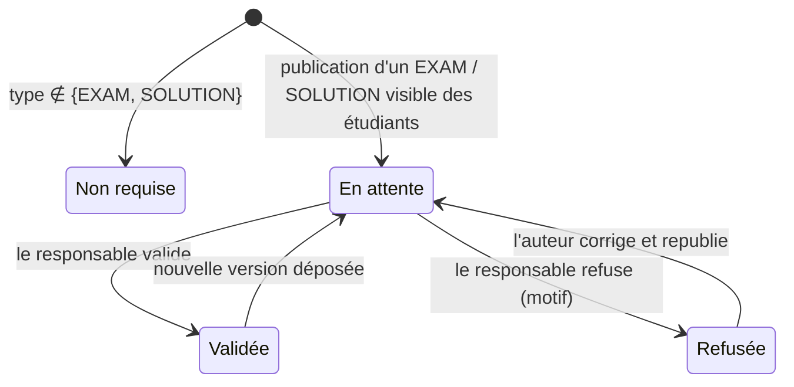

Un étudiant ne voit la ressource que si elle est **Validée** et que sa date de publication est **atteinte**.

## 4. Diagrammes de séquence

### 4.1 Dépôt d'une ressource (F9)

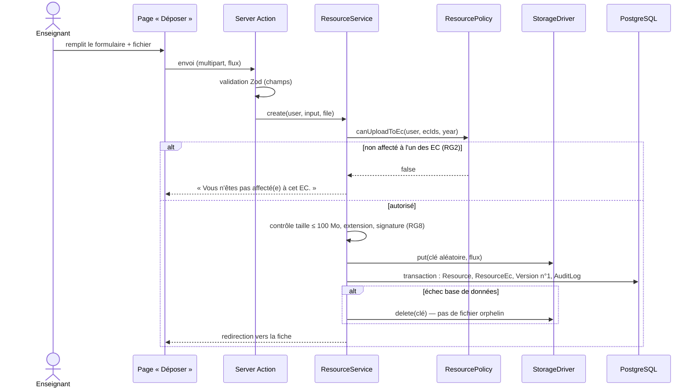

### 4.2 Téléchargement contrôlé (RG2–RG7, RG10)

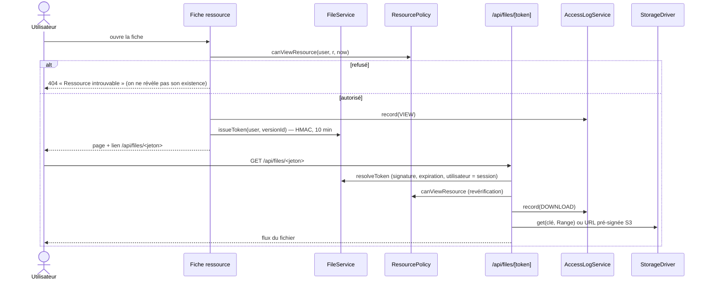
