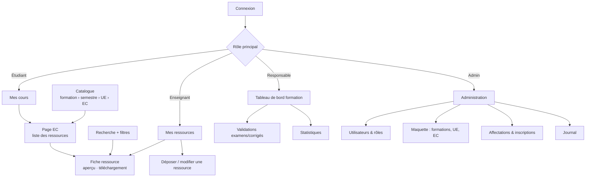

# Maquettes des écrans principaux — RessourcesPéda

Ce sont des maquettes **filaires**, en texte, qui fixent le contenu et l'organisation de chaque écran. Le style graphique sera défini au Lot 1 avec Tailwind : couleurs de l'UASZ à préciser, polices système.
Les écrans sont pensés **d'abord pour le téléphone** (≈ 360 px de large). Sur ordinateur, la navigation passe dans une barre latérale gauche et les listes s'élargissent.

## 0. Plan du site et navigation



**Barre de navigation sur téléphone** : barre en bas avec 4 entrées au plus, selon les rôles.
- Étudiant : `Mes cours` · `Rechercher` · `Favoris` · `Notifications`
- Enseignant : `Mes ressources` · `Catalogue` · `Rechercher` · `Plus ▾` (tableau de bord, favoris, profil)
- Le responsable et l'administrateur ont en plus une entrée `Gestion`.

**Parcours « 3 clics » (critère du Lot 3)** : `Mes cours` → *EC* (1) → *ressource* (2) → *Télécharger* (3).

---

## 1. Connexion (F1)

```
┌──────────────────────────────────┐
│        [logo UASZ]               │
│        RessourcesPéda            │
│                                  │
│  Adresse électronique            │
│  ┌────────────────────────────┐  │
│  │ prenom.nom@uasz.sn         │  │
│  └────────────────────────────┘  │
│  Mot de passe                    │
│  ┌──────────────────────────┐👁 │
│  │ ••••••••                 │   │
│  └──────────────────────────┘   │
│                                  │
│  [        Se connecter        ]  │
│                                  │
│  Mot de passe oublié ?           │
│                                  │
│  ⚠ Adresse ou mot de passe       │
│    incorrect.  (message unique)  │
└──────────────────────────────────┘
```

## 2. Étudiant — Mes cours (F20)

```
┌──────────────────────────────────┐
│ ☰  Mes cours            🔔2  (JS)│
├──────────────────────────────────┤
│ Master MIO · niveau 1 · 2026-2027│
│ ┌──────────┬──────────┐          │
│ │Semestre 1│Semestre 2│  (onglets)│
│ └──────────┴──────────┘          │
│                                  │
│ ▸ UE1 — Mathématiques            │
│   ┌────────────────────────────┐ │
│   │ Optimisation linéaire      │ │
│   │ 12 ressources · 2 nouvelles│ │
│   └────────────────────────────┘ │
│   ┌────────────────────────────┐ │
│   │ Analyse numérique          │ │
│   │ 8 ressources               │ │
│   └────────────────────────────┘ │
│ ▸ UE2 — Informatique             │
│   ┌────────────────────────────┐ │
│   │ Programmation Python       │ │
│   │ 15 ressources · 1 nouvelle │ │
│   └────────────────────────────┘ │
├──────────────────────────────────┤
│ 📚Mes cours 🔍Rechercher ★Favoris 🔔│
└──────────────────────────────────┘
```

« Nouvelle » signifie publiée depuis la dernière visite de l'EC. Si l'étudiant n'a pas d'inscription pour l'année en cours, l'écran affiche : *« Vous n'êtes inscrit(e) dans aucune formation pour l'année 2026-2027. Contactez la scolarité. »*

## 3. Page d'un EC — liste des ressources (F17, F19)

```
┌──────────────────────────────────┐
│ ←  Optimisation linéaire         │
│ Master MIO › S1 › UE1 › EC1      │
│ Enseignant(e)s : A. Diallo       │
│ [☆ Suivre cet EC]  (F22)         │
├──────────────────────────────────┤
│ Type: [Tous ▾]  Format: [Tous ▾] │
├──────────────────────────────────┤
│ 📄 Chapitre 1 — Simplexe     ★   │
│    Cours · PDF · 2,1 Mo · v3     │
│    Publié le 03/11/2026          │
├──────────────────────────────────┤
│ 📝 TD 2 — Dualité                │
│    TD · PDF · 450 Ko             │
├──────────────────────────────────┤
│ 🎬 Démonstration solveur         │
│    Vidéo · lien YouTube          │
├──────────────────────────────────┤
│ 🧪 TP1 — PuLP                    │
│    TP · ZIP · 1,2 Mo             │
├──────────────────────────────────┤
│      ‹ Précédent   1/3  Suivant ›│
└──────────────────────────────────┘
```

Vue enseignant de la même page : chaque ligne affiche en plus un badge d'état (`Brouillon`, `Programmée 15/12`, `En attente de validation`, `Privée`), et un bouton `+ Déposer dans cet EC` apparaît si l'enseignant y est affecté.

## 4. Recherche (F18, F19)

```
┌──────────────────────────────────┐
│ ┌────────────────────────────┐🔍 │
│ │ simplexe dualité           │   │
│ └────────────────────────────┘   │
│ [Filtres (2) ▾]                  │
│ ┌─ Filtres ──────────────────┐   │
│ │ Type      [Cours][TD][TP]… │   │
│ │ Enseignant [Tous       ▾]  │   │
│ │ Année      [2026-2027  ▾]  │   │  ← étudiants : année en cours
│ │ Format     [PDF][Vidéo]…   │   │     seulement (RG7)
│ │ [Réinitialiser] [Appliquer]│   │
│ └────────────────────────────┘   │
│ 14 résultats                     │
│ 📄 Chapitre 1 — **Simplexe**     │
│    Optimisation linéaire · Cours │
│    « …méthode du **simplexe**…»  │
│ 📝 TD 2 — **Dualité**            │
│    Optimisation linéaire · TD    │
│          [Afficher plus]         │
└──────────────────────────────────┘
```

Les filtres sont envoyés par un formulaire GET (`?q=…&type=…`). La recherche fonctionne donc sans JavaScript et l'URL peut être partagée.

## 5. Fiche ressource (F12, RG6, RG10)

```
┌──────────────────────────────────┐
│ ←  Chapitre 1 — Simplexe      ★  │
├──────────────────────────────────┤
│ Cours · Optimisation linéaire    │
│ par A. Diallo · v3 du 03/11/2026 │
│ Mots-clés : simplexe, PL, base   │
│                                  │
│ Introduction à la méthode du     │
│ simplexe : forme standard…       │
│                                  │
│ PDF · 2,1 Mo                     │
│ [👁 Aperçu]  [⬇ Télécharger]     │
│ ┌────────────────────────────┐   │
│ │ (aperçu PDF chargé au clic) │   │
│ └────────────────────────────┘   │
├──────────────────────────────────┤
│ Visible par l'auteur, le responsable :
│ ▾ Historique des versions        │
│   v3 03/11 « Correction ex. 4 »  │
│   v2 20/10 « Ajout chapitre 1.3 »│
│   v1 01/10 « Version initiale »  │
├──────────────────────────────────┤
│ Visible par l'auteur :           │
│ [Modifier] [Nouvelle version]    │
│ [Dépublier] [Dupliquer] [Archiver]│
│ 👁 134 vues · ⬇ 87 téléchargements│
└──────────────────────────────────┘
```

## 6. Enseignant — Déposer / modifier une ressource (F9, F10, F13)

```
┌──────────────────────────────────┐
│ ←  Déposer une ressource         │
├──────────────────────────────────┤
│ Titre *                          │
│ [______________________________] │
│ Description                      │
│ [______________________________] │
│ [______________________________] │
│ Type *  [Cours ▾]                │
│ EC *  (seulement mes EC — RG2)   │
│ ☑ Optimisation linéaire (M1 S1)  │
│ ☐ Recherche opérationnelle (M1 S2)│
│ Mots-clés  [simplexe ×][PL ×][__]│
│                                  │
│ Contenu *  (•) Fichier  ( ) Lien │
│ [Choisir un fichier…]            │
│ PDF, DOCX, PPTX, XLSX, ODT, ZIP, │
│ MP4, MP3, PNG, JPG, TXT, code ;  │
│ 100 Mo max.                      │
│ ▓▓▓▓▓▓▓░░░ 68 %  (progression)   │
│                                  │
│ Visibilité *                     │
│ ( ) Privée — moi seul(e)         │
│ ( ) Enseignants                  │
│ (•) Étudiants de l'EC            │
│                                  │
│ Publication                      │
│ ( ) Enregistrer en brouillon     │
│ (•) Publier maintenant           │
│ ( ) Programmer le [__/__/__ __h] │
│                                  │
│ ⓘ Sujet d'examen / corrigé :     │
│   date obligatoire ; publication │
│   soumise à validation du        │
│   responsable de formation.      │
│                                  │
│ [Annuler]          [Enregistrer] │
└──────────────────────────────────┘
```

Le message ⓘ n'apparaît que pour les types `Sujet d'examen` et `Corrigé`. En modification, si un nouveau fichier est choisi, un champ obligatoire **« Commentaire de version »** s'affiche (F10).

## 7. Enseignant — Mes ressources

```
┌──────────────────────────────────┐
│ Mes ressources     [+ Déposer]   │
│ Année [2026-2027 ▾]              │
│ [Toutes][Brouillons][Publiées]   │
│ [Programmées][En attente][Archivées]
├──────────────────────────────────┤
│ Chapitre 1 — Simplexe            │
│ Optim. linéaire · Publiée · v3   │
│ 👁134 ⬇87                     ⋮  │
├──────────────────────────────────┤
│ Examen final 2026                │
│ Optim. linéaire                  │
│ ⏳ En attente de validation       │
│ Publication prévue le 15/01/2027 ⋮│
├──────────────────────────────────┤
│ TP3 (brouillon)                  │
│ Prog. Python · Brouillon · v1  ⋮ │
└──────────────────────────────────┘
```

## 8. Responsable — Validations (F14)

```
┌──────────────────────────────────┐
│ Validations — Master MIO   (3)   │
├──────────────────────────────────┤
│ Examen final — Optim. linéaire   │
│ A. Diallo · Sujet d'examen       │
│ Publication demandée : 15/01/2027│
│ [👁 Voir]  [✔ Valider] [✖ Refuser]│
├──────────────────────────────────┤
│ Corrigé TD noté — Analyse num.   │
│ M. Ndiaye · Corrigé              │
│ Publication demandée : 20/12/2026│
│ [👁 Voir]  [✔ Valider] [✖ Refuser]│
└──────────────────────────────────┘
 Refuser → boîte de dialogue :
 « Motif du refus * [__________] [Confirmer] »
```

## 9. Responsable — Tableau de bord de la formation (F24)

```
┌──────────────────────────────────┐
│ Tableau de bord — Master MIO     │
│ Année [2026-2027 ▾]  [Export CSV]│
├──────────────────────────────────┤
│ ┌───────┐ ┌───────┐ ┌───────┐    │
│ │  86   │ │ 3/14  │ │ 2 140 │    │
│ │ress.  │ │EC sans│ │consult.│   │
│ │publ.  │ │ress.  │ │ (30 j) │   │
│ └───────┘ └───────┘ └───────┘    │
│                                  │
│ ⚠ EC sans ressource              │
│  • Anglais scientifique (S1)  →  │
│  • Stage — méthodologie (S2)  →  │
│  • Droit du numérique (S2)    →  │
│                                  │
│ Ressources par EC                │
│  Optim. linéaire   ████████ 12   │
│  Prog. Python      ██████████ 15 │
│  Analyse num.      █████ 8       │
│                                  │
│ Les plus consultées (30 j)       │
│  1. Chapitre 1 — Simplexe   134  │
│  2. TP1 — PuLP               98  │
│  3. Cours Python — bases     91  │
└──────────────────────────────────┘
```

Chiffres agrégés uniquement, jamais de liste nominative d'étudiants (A12). Le tableau de bord enseignant (F23) reprend la même présentation, limitée à ses propres ressources.

## 10. Administration — Maquette de formation (F5, F6)

```
┌──────────────────────────────────────────────────────────┐
│ Administration › Formations › Master MIO      [Modifier] │
│ Code M-MIO · Cycle Master · Responsable : A. Diallo      │
├──────────────────────────────────────────────────────────┤
│ Semestre 1 (niveau 1)                         [+ UE]     │
│   UE1 Mathématiques · 12 crédits              [+ EC] ✎ 🗄 │
│     EC1 Optimisation linéaire · 6 cr.                    │
│         Enseignants 2026-2027 : A. Diallo  [Affecter]  ✎ 🗄│
│     EC2 Analyse numérique · 6 cr.                        │
│         Enseignants 2026-2027 : M. Ndiaye  [Affecter]  ✎ 🗄│
│   UE2 Informatique · 12 crédits               [+ EC] ✎ 🗄 │
│     …                                                    │
│ Semestre 2 (niveau 1)                         [+ UE]     │
│     …                                                    │
└──────────────────────────────────────────────────────────┘
 🗄 = archiver (F5) ; un élément archivé reste visible, grisé, avec « Restaurer ».
```

## 11. Administration — Utilisateurs (F2, F3, F7)

```
┌──────────────────────────────────────────────────────────┐
│ Utilisateurs     [+ Nouveau]  [Importer CSV]             │
│ 🔍 [nom, courriel…]  Rôle [Tous ▾]  Actif [Oui ▾]        │
├──────────────┬────────────────────┬──────────────┬───────┤
│ Nom          │ Courriel           │ Rôles        │       │
├──────────────┼────────────────────┼──────────────┼───────┤
│ DIALLO Awa   │ a.diallo@…         │ Ens. · Resp. │ ✎ ⏻  │
│ NDIAYE Moussa│ m.ndiaye@…         │ Enseignant   │ ✎ ⏻  │
│ SARR Fatou   │ f.sarr@…           │ Étudiante    │ ✎ ⏻  │
│              │                    │ M-MIO niv. 1 │       │
├──────────────┴────────────────────┴──────────────┴───────┤
│                         ‹ 1 2 3 ›                        │
└──────────────────────────────────────────────────────────┘
 ⏻ = activer/désactiver (pas de suppression de compte en V1)
```
