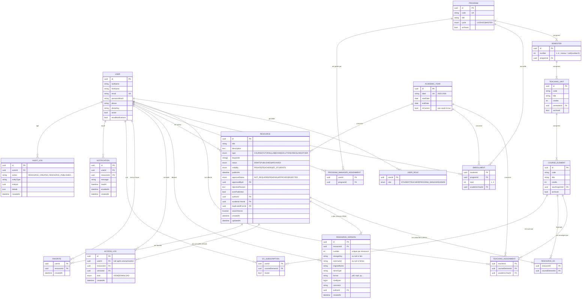

# Modèle de données — RessourcesPéda

Ce modèle reprend les entités du cahier des charges (§6). Il ajoute celles qu'exigent les fonctionnalités et les solutions proposées dans [`ambiguites.md`](ambiguites.md), marquées ➕ ci-dessous.
Les noms de tables et de champs sont en anglais (convention de code) ; la correspondance avec les termes français est donnée au §3.

## 1. Diagramme entité-association



Entité technique non représentée : `PasswordResetToken` (userId, tokenHash, expiresAt, usedAt). Les entités d'Auth.js ne sont pas nécessaires : la session est stockée en JWT.

## 2. Contraintes et index

| Table | Contrainte / index | Raison |
| --- | --- | --- |
| `User` | `email` unique (insensible à la casse, via `citext` ou stockage en minuscules) | F1 |
| `UserRole` | clé primaire (`userId`, `role`) | plusieurs rôles par utilisateur (F2) |
| `Semester` | unique (`programId`, `number`) | RG1 |
| `TeachingUnit`, `CourseElement` | unique (`semesterId`, `code`) / (`teachingUnitId`, `code`) | codes uniques dans leur parent |
| `AcademicYear` | index unique partiel `WHERE is_current` | une seule année en cours (A16) |
| `TeachingAssignment` | clé primaire (`teacherId`, `courseElementId`, `academicYearId`) | RG2 |
| `Enrollment` | unique (`studentId`, `academicYearId`) | un étudiant a une seule inscription par an |
| `ResourceEc` | clé primaire (`resourceId`, `courseElementId`) ; ≥ 1 ligne par ressource, vérifié par le service | RG1 |
| `ResourceVersion` | unique (`resourceId`, `number`) ; CHECK (`storageKey` IS NOT NULL) XOR (`externalUrl` IS NOT NULL) ; CHECK `sizeBytes ≤ 100 Mo` | RG6, RG8 |
| `Resource` | index GIN sur `searchVector` ; index (`status`, `visibility`, `academicYearId`) ; index `authorId` | F18, F19, performance |
| `AccessLog` | index (`resourceId`, `kind`, `createdAt`) | statistiques F23, F24 |
| `Favorite` | clé primaire (`userId`, `resourceId`) | F21 |
| `AuditLog` | index (`entityType`, `entityId`), index `createdAt` | F25 |

**Suppressions.** Pas de suppression en cascade sur les ressources publiées : l'archivage est logique (RG9). La suppression définitive par l'administrateur supprime en cascade les versions, `ResourceEc`, les favoris et les notifications, ainsi que les fichiers du stockage. Les `AccessLog` sont conservés avec `resourceId` mis à null, pour garder les totaux.

## 3. Correspondance avec le cahier des charges

| Cahier des charges | Modèle | Remarque |
| --- | --- | --- |
| Utilisateur | `User` + `UserRole` | rôles multiples (F2) ; `photoKey` et `emailNotifications` pour F4 et F22 |
| Formation (niveau Licence/Master) | `Program.cycle` | le « niveau » d'étude est porté par l'inscription (A1) |
| Semestre | `Semester` | |
| UE | `TeachingUnit` | |
| EC | `CourseElement` | |
| AnneeUniversitaire | `AcademicYear` | |
| Affectation | `TeachingAssignment` | |
| Inscription | `Enrollment` | |
| Ressource | `Resource` + `ResourceEc` | ➕ `approvalStatus` (RG5, A5), `everPublished` (A7), `duplicatedFromId` (F15) |
| Version | `ResourceVersion` | |
| Consultation | `AccessLog` | `kind` = `VIEW` / `DOWNLOAD` |
| Favori | `Favorite` | |
| ➕ Responsable ↔ formation | `ProgramManagerAssignment` | A3 |
| ➕ EC suivi | `EcSubscription` | F22, A10 |
| ➕ Notification | `Notification` | F22 |
| ➕ Journal | `AuditLog` | F25 |
| ➕ Réinitialisation du mot de passe | `PasswordResetToken` | F1 |
| (F16, priorité C) Commentaires et notes | `ResourceComment`, `ResourceRating` | reportés après la version 1, sauf avis contraire |

## 4. Valeurs des énumérations et libellés français

| Enum | Valeur | Libellé affiché |
| --- | --- | --- |
| `Role` | `STUDENT` / `TEACHER` / `PROGRAM_MANAGER` / `ADMIN` | Étudiant / Enseignant / Responsable de formation / Administrateur |
| `ResourceType` | `COURSE` / `TUTORIAL` / `LAB` / `EXAM` / `SOLUTION` / `VIDEO` / `LINK` / `OTHER` | Cours / TD / TP / Sujet d'examen / Corrigé / Vidéo / Lien / Autre |
| `ResourceStatus` | `DRAFT` / `PUBLISHED` / `ARCHIVED` | Brouillon / Publiée (ou « Programmée » si `publishAt` est dans le futur) / Archivée |
| `Visibility` | `PRIVATE` / `TEACHERS` / `EC_STUDENTS` | Privée / Enseignants / Étudiants de l'EC |
| `ApprovalStatus` | `NOT_REQUIRED` / `PENDING` / `APPROVED` / `REJECTED` | — / En attente de validation / Validée / Refusée |
| `AccessKind` | `VIEW` / `DOWNLOAD` | Consultation / Téléchargement |

## 5. Calcul de la visibilité étudiante (RG3, RG4, RG5, RG7)

Expression du filtre `visibleResourcesWhere` pour un étudiant, sous forme de pseudo-SQL :

```sql
r.status = 'PUBLISHED'
AND r.visibility = 'EC_STUDENTS'
AND (r.publish_at IS NULL OR r.publish_at <= now())
AND r.academic_year_id = :currentYearId
AND (r.type NOT IN ('EXAM','SOLUTION') OR r.approval_status = 'APPROVED')
AND EXISTS (
  SELECT 1
  FROM resource_ec re
  JOIN course_element ce ON ce.id = re.course_element_id
  JOIN teaching_unit tu ON tu.id = ce.teaching_unit_id
  JOIN semester s ON s.id = tu.semester_id
  JOIN enrollment e ON e.program_id = s.program_id
  WHERE re.resource_id = r.id
    AND e.student_id = :userId
    AND e.academic_year_id = :currentYearId
    AND e.level = CEIL(s.number / 2.0)
)
```

Pour les ressources de type `EXAM` et `SOLUTION`, `publishAt` est obligatoire (A5) : la condition `publish_at IS NULL` ne s'applique jamais à eux.
